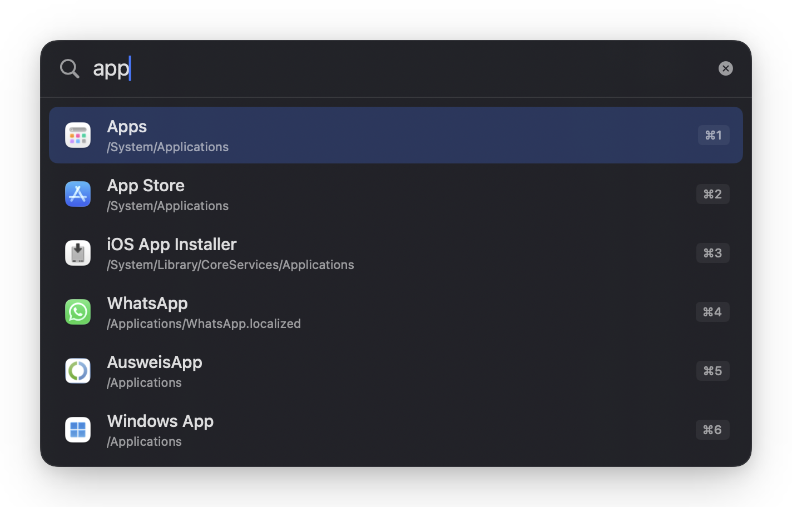
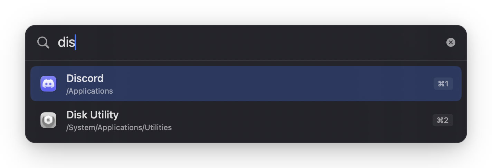
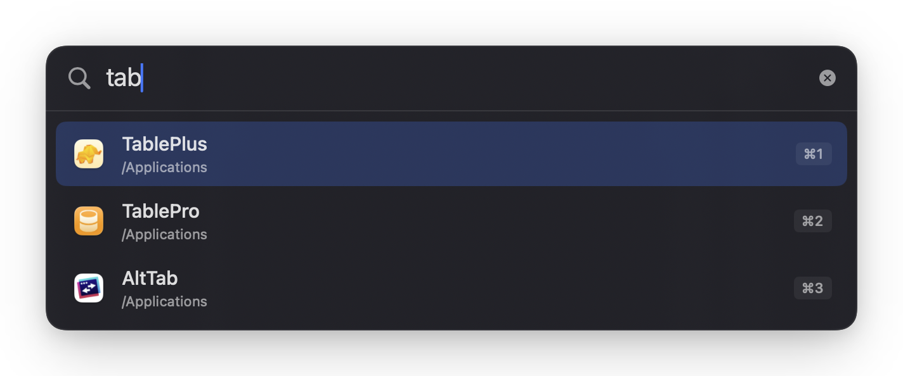
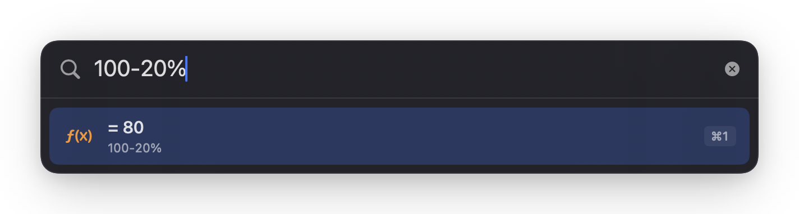
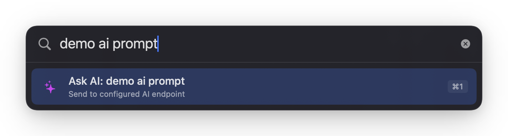

# Simple Launcher

A minimal Alfred/Sol-style macOS launcher built with native SwiftUI.

## Features

- **App launcher** — fuzzy search installed apps, open with Return or ⌘1–⌘9
- **Calculator** — math in the search field, including percentages (`100-20%` → `80`)
- **Ask AI** — OpenAI-compatible chat, or a local Codex, Claude, Cursor Agent, or OpenCode CLI. Trigger with `?` / `ask `, or as a fallback when nothing matches. Optional [Tavily](https://tavily.com) web search when the API provider is selected and a key is set
- **Launch at login** — optional startup via Settings

## Screenshots

<p align="center">
  
</p>

<p align="center">
  
</p>

<p align="center">
  
</p>

<p align="center">
  
</p>

<p align="center">
  
</p>

<p align="center">
  
</p>

<p align="center">
  
</p>

## Requirements

- macOS 14+ (Apple Silicon)
- Xcode 15+

## Download & install

Download `SimpleLauncher-macos-arm64.zip` from [GitHub Releases](https://github.com/buldezir/simple-mac-launcher/releases), extract it, and drag `SimpleLauncher.app` into `/Applications`.

Release downloads require macOS 14+ on Apple Silicon; Xcode is only needed to build from source. The app is ad hoc signed and is not notarized. If macOS blocks the first launch, open **System Settings → Privacy & Security → Open Anyway**, then confirm opening the app. See [Apple's instructions](https://support.apple.com/en-us/102445).

Publishing a GitHub release (including a prerelease) runs the release workflow, which builds its tag and attaches the ZIP. No Apple signing secrets are required. To retry a failed build, rerun the workflow from GitHub Actions; a successful rerun replaces the asset with the same name.

## Build & run

```sh
./build.sh
```

Builds a Debug app under `build/DerivedData/`.

Pass `Release` to build and install to `/Applications`:

```sh
./build.sh Release
```

Or open in Xcode:

```sh
open SimpleLauncher.xcodeproj
```

Select the **SimpleLauncher** scheme and press Run.

The app runs as a menu bar accessory (no Dock icon).

## Usage

| Action | How |
| --- | --- |
| Toggle launcher | **⌥ Space** (Alt+Space), or menu bar → Show Launcher |
| Launch app | Type name → Return / click / ⌘1–⌘9 |
| Calculate | Type `100-20%` → Return copies result |
| Ask AI (prefix) | `? your question` or `ask your question` → Return to send |
| Ask AI (fallback) | Type something with no app matches → select Ask AI |
| Browse AI history | `/h`, optionally `/h filter` |
| Delete a history entry | **⌘⌫** on the highlighted entry, or hover → trash |
| Settings | Menu bar → Settings…, or **⌘,** |
| Launch at login | Settings → Launch at login |
| Dismiss | Esc or click outside (focus returns to the previous app) |

### Ask AI settings

In Settings, choose a **Provider**.

**API** — OpenAI-compatible Chat Completions:

1. **Endpoint** — e.g. `https://api.openai.com/v1` or `https://opencode.ai/zen/go/v1/chat/completions`
2. **API key** — stored in UserDefaults (personal use; no Keychain prompts)
3. **Model name** — e.g. `deepseek-v4-flash` (tool calling required for web search)
4. **Tavily API key** (optional) — enables `web_search` and `web_fetch`; free tier at [tavily.com](https://tavily.com)

Requests go to `{endpoint}/chat/completions` (OpenAI-compatible streaming). When Tavily is configured, Ask AI may call `web_search` / `web_fetch` (up to a few rounds) before answering.

**Codex, Claude, Cursor Agent, or OpenCode** — runs the CLI already installed on this Mac (`codex`, `claude`, `cursor-agent`, or `opencode`) and uses that CLI’s login (`codex login`, `claude auth login`, `cursor-agent login`, or `opencode auth login`). No API key in the launcher. Off by default, the CLI stays read-only. **Auto mode** lets it edit files and run commands in your home folder. Optional **Model** and **Executable** override the CLI default and the auto-detected binary (Homebrew, `~/.local/bin`, `~/.opencode/bin`, then your login PATH). Settings shows an error when the selected CLI is not installed.

AI answers appear in an inline markdown pane under the search field. **Return** copies the plain-text answer; **Esc** exits answer mode.

## Notes

- App Sandbox is off so the launcher can open apps and call custom AI endpoints.
- If Alt+Space does not work, another app may already own that hotkey (e.g. Spotlight alternatives).
